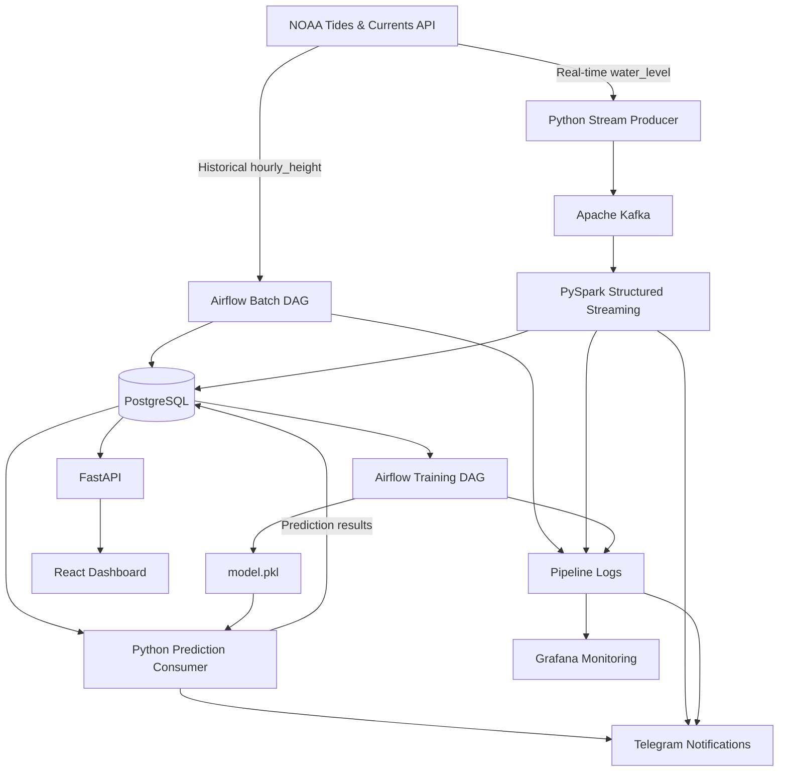

# NOAA Water Level Forecasting and Coastal Flood Risk Monitoring System

An end-to-end data pipeline and forecasting system that collects historical and real-time water level observations from the NOAA Tides & Currents API, processes streaming data, generates one-hour-ahead predictions, and monitors potential coastal flood risks.

The system combines batch processing, stream processing, machine learning, data storage, and real-time monitoring in a single workflow.

## Overview

The project uses NOAA water level data from the following monitoring station:

| Parameter | Value |
|---|---|
| Station ID | `8638610` |
| Station Name | Sewells Point |
| Location | Norfolk, Virginia, USA |
| Region | Hampton Roads / Chesapeake Bay |
| Datum | MHHW |
| Measurement Unit | Metric (meters) |

The system processes historical and real-time observations to forecast water levels one hour ahead and classify potential flood risk based on configured water-level thresholds.

## Key Features

- Historical data ingestion and batch processing
- Real-time data ingestion through Apache Kafka
- Stream processing with PySpark Structured Streaming
- Data storage and management using PostgreSQL
- Automated model training and monthly retraining
- One-hour-ahead water level forecasting
- Threshold-based coastal flood risk classification
- Interactive dashboard for water level visualization
- Pipeline monitoring, logging, and data quality checks
- Telegram notifications for pipeline events and alerts

## Architecture

The system consists of eight main components:

1. **Data Source:** NOAA Tides & Currents API provides historical and real-time water level observations.
2. **Stream Ingestion:** A Python producer retrieves real-time observations and publishes messages to Apache Kafka.
3. **Stream Processing:** PySpark Structured Streaming consumes Kafka messages, performs transformations, aggregations, and anomaly checks.
4. **Storage:** PostgreSQL stores historical records, cleaned data, streaming observations, hourly aggregates, prediction results, model metadata, and pipeline logs.
5. **Prediction Layer:** A Python prediction consumer performs feature engineering, loads the trained model, and generates one-hour-ahead forecasts.
6. **Serving & Frontend:** FastAPI provides prediction and data endpoints, while React presents the results through an interactive dashboard.
7. **Monitoring & Alerts:** Grafana monitors pipeline operations and system metrics, while Telegram delivers notifications and alerts.
8. **Batch & Model Training:** Apache Airflow orchestrates historical batch processing, model training, registration, and monthly retraining.

### Data Flow



## Data Source

The project uses the [NOAA Tides & Currents API](https://api.tidesandcurrents.noaa.gov/api/prod/).

Two data products are used:

| Data Product | Purpose | Interval |
|---|---|---|
| `hourly_height` | Historical batch processing and model training | Hourly |
| `water_level` | Real-time stream ingestion and monitoring | 6 minutes |

Historical observations are used to build the training dataset and support batch processing. Real-time observations are continuously collected for stream processing and forecasting.

### Streaming Interval

The real-time producer operates on a six-minute polling interval to align with the observation interval provided by NOAA's `water_level` product.

This approach avoids unnecessary polling while maintaining consistency with the source data frequency.

NOAA also applies request-length limits depending on the selected data interval. Six-minute water level requests are limited to one month per request, while hourly requests are limited to one year.

See the [NOAA CO-OPS API documentation](https://api.tidesandcurrents.noaa.gov/api/dev/).

## Technology Stack

| Component | Technology | Purpose |
|---|---|---|
| Programming Language | Python | Data ingestion, processing, and prediction |
| Data Source | NOAA API | Water level observations |
| Workflow Orchestration | Apache Airflow | Batch processing and model training |
| Message Broker | Apache Kafka | Real-time message ingestion |
| Stream Processing | PySpark Structured Streaming | Streaming transformations and aggregations |
| Database | PostgreSQL | Central data storage |
| Machine Learning | Python / scikit-learn-compatible model interface | Water level forecasting |
| Backend | FastAPI | Data and prediction API |
| Frontend | React | Interactive dashboard |
| Monitoring | Grafana | Pipeline and system monitoring |
| Notifications | Telegram Bot API | Pipeline and prediction alerts |
| Containerization | Docker Compose | Service orchestration |

## Repository Structure

```text
noaa-rob-pipeline/
│
├── backend/                 # FastAPI application
├── frontend/                # React dashboard
├── dags/                    # Apache Airflow DAGs
│
├── scripts/                 # Execution scripts
│
├── src/
│   ├── batch/               # Historical batch processing
│   ├── streaming/           # Kafka producer and Spark streaming
│   ├── training/            # Model training and registration
│   ├── prediction/          # Prediction consumer
│   └── utils/               # Database, logging, and Telegram utilities
│
├── sql/                     # Database schemas and SQL scripts
├── models/                  # Trained model artifacts
├── grafana/                 # Grafana dashboard configuration
│
├── docker-compose.yml
├── .env.example
└── README.md
```

## Getting Started

### Prerequisites

Make sure the following tools are installed:

- Docker Desktop or Docker Engine
- Docker Compose
- Git

### 1. Clone the Repository

```bash
git clone <repository-url>
cd noaa-rob-pipeline
```

### 2. Configure Environment Variables

Create a local environment file from the example:

**Windows PowerShell**

```powershell
Copy-Item .env.example .env
```

**Linux / macOS**

```bash
cp .env.example .env
```

Configure the required environment variables:

```env
POSTGRES_DB=noaa_rob
POSTGRES_USER=noaa_user
POSTGRES_PASSWORD=your_password
POSTGRES_HOST=postgres
POSTGRES_PORT=5432

KAFKA_BOOTSTRAP_SERVERS=kafka:9092
KAFKA_TOPIC_RAW=noaa_water_level_raw

TELEGRAM_BOT_TOKEN=your_bot_token
TELEGRAM_CHAT_ID=your_chat_id
```

Replace the placeholder values with your own configuration.

Do not commit the `.env` file or expose API credentials and bot tokens in the repository.

### 3. Start the Services

Run the application using Docker Compose:

```bash
docker compose up -d
```

Check the running containers:

```bash
docker compose ps
```

### 4. Access the Services

Once the containers are running, the following services are available:

| Service | Local URL |
|---|---|
| Apache Airflow | http://localhost:8080 |
| FastAPI | http://localhost:8000 |
| React Dashboard | http://localhost:5173 |
| Grafana | http://localhost:3000 |
| PostgreSQL | localhost:5433 |

The PostgreSQL port above refers to the host-side mapping. Services running inside Docker use the configured internal PostgreSQL connection.

## Pipeline Workflows

### Historical Batch Processing

The `dag_batch_noaa_historical` DAG handles historical data ingestion and preparation.

Main operations:

1. Retrieve historical hourly water level observations from NOAA.
2. Store the raw records.
3. Transform and clean the collected data.
4. Perform data quality checks.
5. Load the processed records into PostgreSQL.

### Real-Time Stream Processing

The streaming pipeline collects real-time water level observations through a Python producer.

Processing workflow:

1. Retrieve the latest observations from NOAA.
2. Publish the records to the `noaa_water_level_raw` Kafka topic.
3. Consume incoming messages using PySpark Structured Streaming.
4. Clean, transform, and aggregate the streaming data.
5. Perform anomaly checks.
6. Store processed records and aggregates in PostgreSQL.

To start the producer manually:

```bash
docker compose exec airflow-webserver python scripts/run_producer_loop.py
```

### Model Training and Retraining

The `dag_train_water_level_model` DAG orchestrates the model training workflow.

The training process:

1. Retrieve cleaned historical data from PostgreSQL.
2. Perform feature preparation and engineering.
3. Train and evaluate model versions.
4. Register the selected model.
5. Save the model artifact as `models/model.pkl`.

The training workflow is configured for monthly retraining to incorporate newer observations.

### Water Level Prediction

The Python prediction consumer reads the latest available observations from PostgreSQL and loads the trained model artifact.

The system generates the following prediction target:

```text
water_level_next_1h_m
```

The prediction results are stored in the `prediction_results` table and made available to the backend API.

Coastal flood risk categories are assigned by comparing observed and predicted water levels against the configured thresholds.

## Dashboard

The React dashboard provides an overview of current water level conditions, historical trends, and forecast results.

The main dashboard features include:

- Current water level
- Predicted water level for the next hour
- Current and predicted risk classifications
- Configured flood-risk threshold
- Historical water level trends
- Risk distribution
- Average water level by month
- Average water level by hour
- Recent prediction records

The dashboard is designed to help users explore water level patterns and understand potential changes in coastal water conditions.

## Monitoring and Observability

Grafana is used to monitor system resources, pipeline execution, and data processing activities.

### System Monitoring

- CPU utilization
- Memory usage
- Disk usage

### Pipeline Monitoring

- Total pipeline logs
- Failed tasks
- Warnings
- Raw data records
- Streaming messages
- Prediction records
- Anomaly counts
- Processed record counts
- Pipeline logs by severity
- Data quality reports

The application uses the following log severity levels:

```text
INFO
DEBUG
WARNING
FATAL
```

Pipeline execution records are also stored in PostgreSQL for operational tracking and troubleshooting.

## Data Quality, Metadata, and Audit

Data quality checks are performed to identify potential issues in the collected and processed observations.

The implemented checks include:

- Missing timestamps
- Missing water level values
- Duplicate timestamps
- Unexpected hourly data gaps
- Extreme water level values
- High sigma values
- NOAA data quality flags

The system also maintains supporting metadata and audit tables:

| Table | Purpose |
|---|---|
| `pipeline_execution_log` | Tracks pipeline execution |
| `data_quality_report` | Stores data quality results |
| `metadata_table_catalog` | Documents database table metadata |
| `pipeline_audit_log` | Maintains pipeline audit records |

These records support pipeline traceability, data validation, and operational auditing.

## Telegram Notifications

Telegram Bot API is integrated to deliver automated notifications for streaming activity, prediction updates, and pipeline events.

Notifications include:

- Real-time stream updates
- Latest water level observations
- Current risk classifications
- Data flags and anomaly information
- Prediction results
- Pipeline failure alerts

Example notification:

```text
[NOAA Stream] Station 8638610

Time: 2026-07-03 12:18:00
Water Level: -0.585 m
Risk: NORMAL
Sigma: 0.006
Flags: 1,0,0,0
```

## Useful Commands

### Container Management

Check running containers:

```bash
docker compose ps
```

View service logs:

```bash
docker logs noaa_kafka --tail=100
docker logs noaa_pyspark_streaming --tail=100
docker logs noaa_backend --tail=100
```

Stop the services:

```bash
docker compose down
```

### PostgreSQL Access

Connect to the database:

```bash
docker exec -it noaa_postgres psql -U noaa_user -d noaa_rob
```

Check the number of records in key tables:

```sql
SELECT COUNT(*) FROM raw_noaa_hourly_water_level;

SELECT COUNT(*) FROM raw_noaa_water_level_stream;

SELECT COUNT(*) FROM prediction_results;

SELECT COUNT(*) FROM pipeline_execution_log;
```

## Project Scope and Limitations

This project is developed as a data engineering and forecasting application using observations from a single NOAA monitoring station.

Forecast outputs and risk classifications depend on the available historical observations, model performance, and configured thresholds.

The system is intended for educational and analytical purposes. It is not an official NOAA forecasting service, an operational flood warning system, or a substitute for official emergency information.

## References

- [NOAA Tides & Currents API](https://api.tidesandcurrents.noaa.gov/api/prod/)
- [NOAA CO-OPS Web Services](https://www.tidesandcurrents.noaa.gov/web_services_info.html)
- [Apache Airflow Documentation](https://airflow.apache.org/docs/)
- [Apache Kafka Documentation](https://kafka.apache.org/documentation/)
- [Apache Spark Structured Streaming](https://spark.apache.org/docs/latest/streaming/index.html)
- [PostgreSQL Documentation](https://www.postgresql.org/docs/)
- [FastAPI Documentation](https://fastapi.tiangolo.com/)
- [React Documentation](https://react.dev/)
- [Grafana Documentation](https://grafana.com/docs/)
- [Docker Compose Documentation](https://docs.docker.com/compose/)
